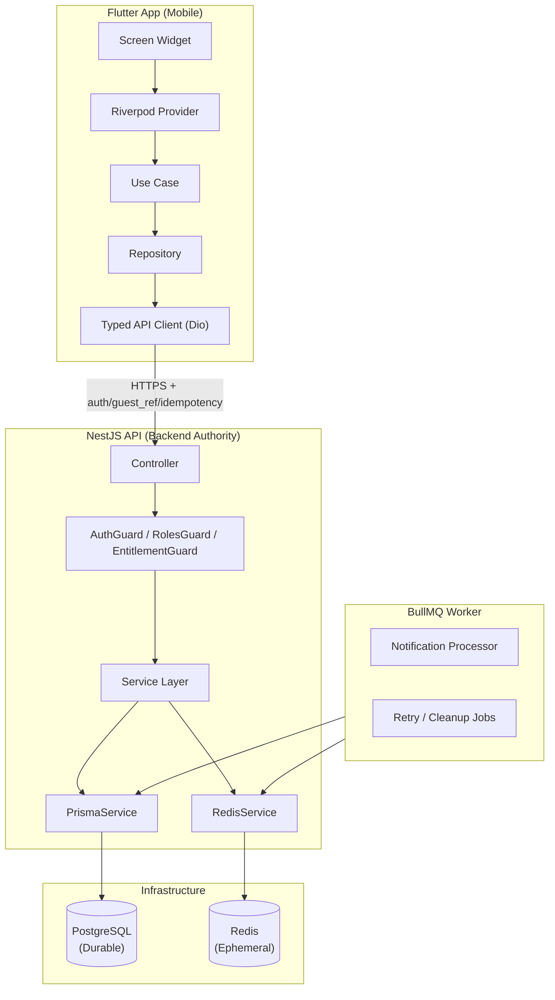
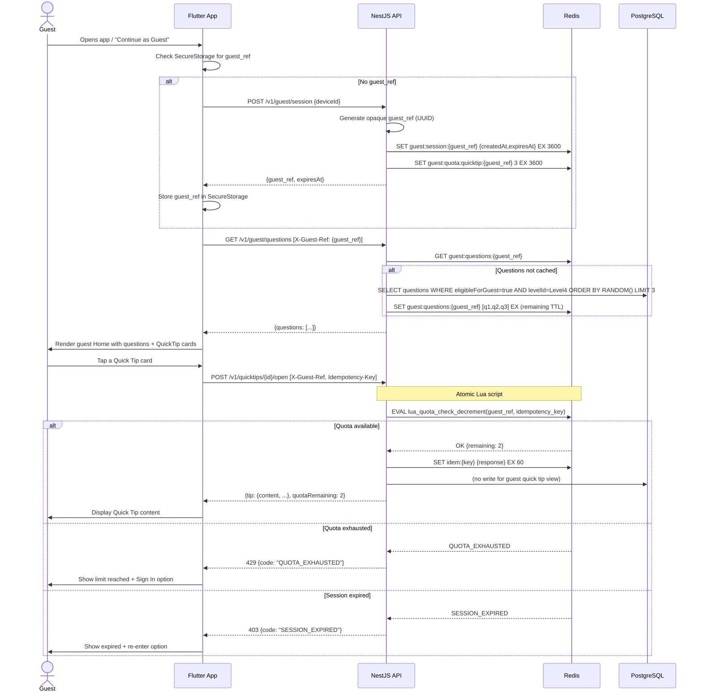
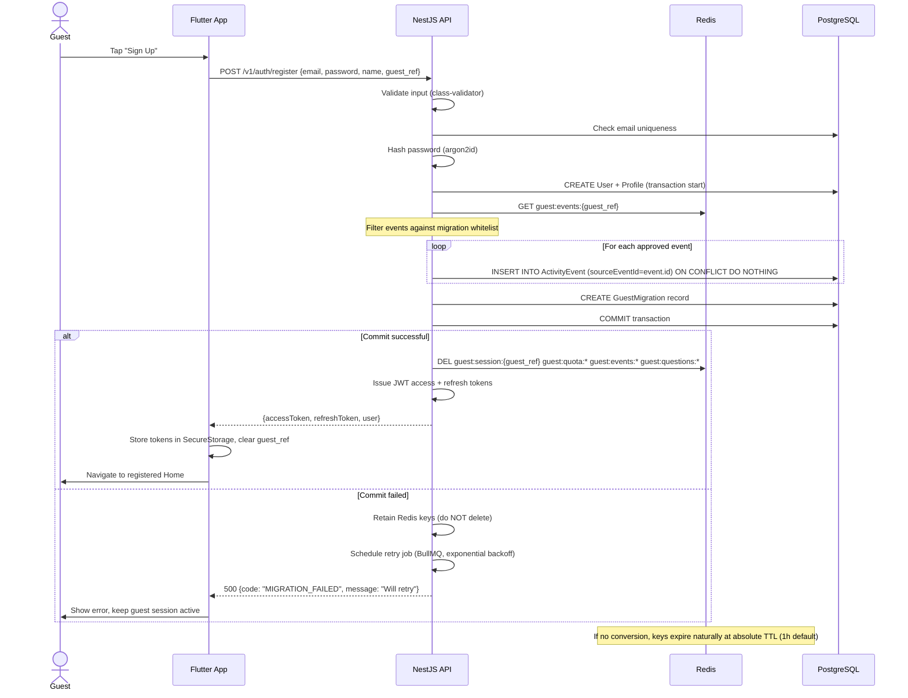
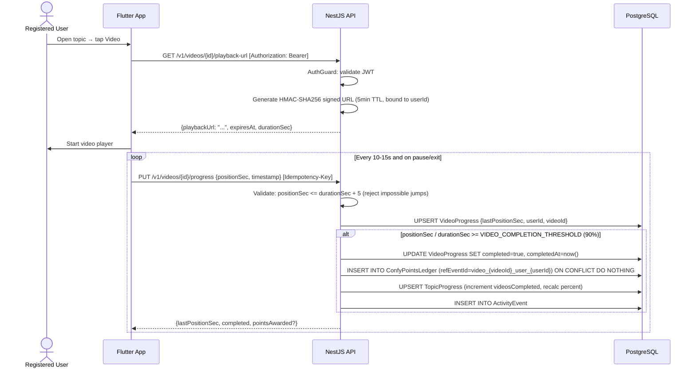
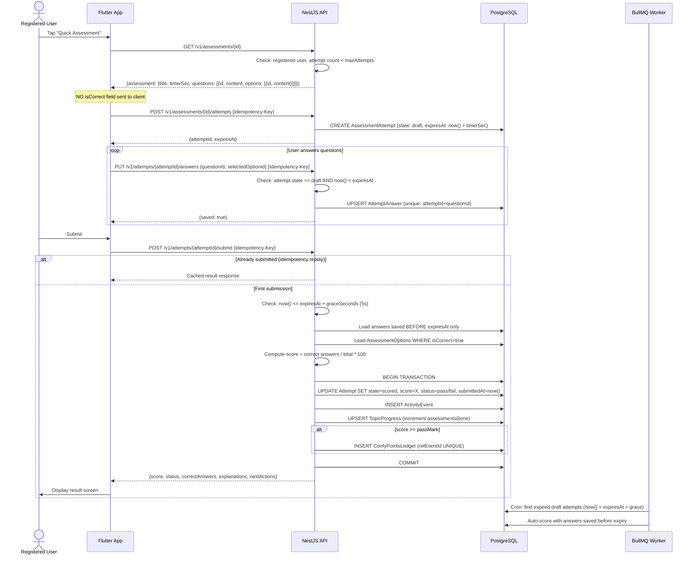
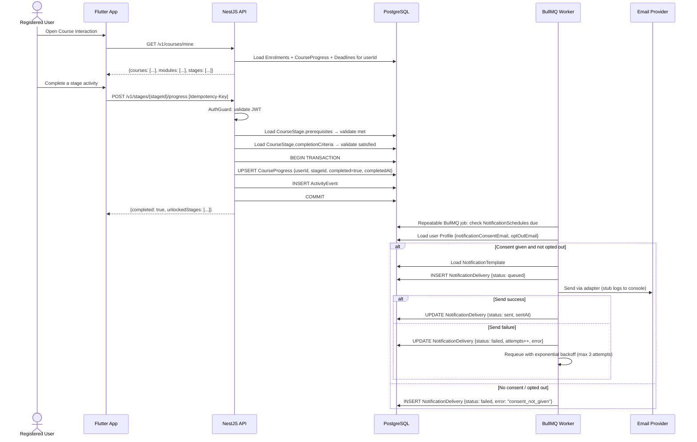
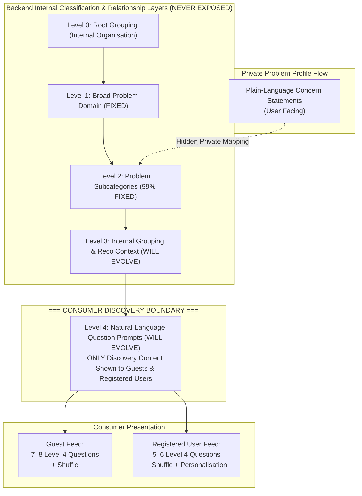

# ConfCircle — Architecture

> Generated as part of Phase E. Sequence diagrams for Flows 02, 03, 05, 06, 09.

## System Overview



## Flow 02 — Guest Entry, Question Selection & Quick Tip



## Flow 03 — Guest Conversion & Expiry



## Flow 05 — Video Solutions & Quick Tip Content



## Flow 06 — Quick Assessment & Results



## Flow 09 — Course Interaction & Notifications



## Level 4 Discovery & Recommendation Architecture (Spec v3.0)

### Taxonomy Hierarchy & Consumer Visibility Boundary



### Discovery Batch & Shuffle Sequence

```mermaid
sequenceDiagram
  actor User as User (Guest or Registered)
  participant Flutter as Flutter Discovery Screen
  participant API as NestJS DiscoveryController
  participant Service as DiscoveryService
  participant PG as PostgreSQL
  participant Redis as Redis

  User->>Flutter: Opens App / Discovery Home
  alt Guest User
    Flutter->>API: GET /v1/discovery/guest?limit=8 [X-Guest-Ref]
    API->>Redis: Check guest:session:{guest_ref} TTL
    API->>Service: getGuestBatch(guestRef, limit=8)
    Service->>PG: Query QuestionPrompt (publishStatus='published', guestEligible=true)
    Service->>Service: Filter out previous batch items; sample diverse 7–8 L4 questions
    Service->>PG: Create DiscoveryBatch
    Service->>Redis: Record impression event
    Service-->>Flutter: {batchId, items: [7-8 Level 4 question items], expiresAt}
  else Registered User
    Flutter->>API: GET /v1/discovery/registered?limit=6 [Bearer]
    API->>Service: getRegisteredBatch(userId, limit=6)
    Service->>PG: Load UserProblemProfile -> mapped L2/L1 taxonomy nodes
    Service->>PG: Load recent events for repeat penalty
    Service->>Service: Score candidates: profile_match + boosts - penalties; sample 5–6 L4 questions
    Service->>PG: Create DiscoveryBatch & DiscoveryEvent
    Service-->>Flutter: {batchId, items: [5-6 Level 4 question items with safe labels]}
  end
  Flutter->>User: Renders QuestionCard batch (Level 4 questions ONLY)

  opt User Taps Shuffle
    User->>Flutter: Tap Shuffle
    Flutter->>Flutter: Show shuffle spinner; KEEP CURRENT CARDS VISIBLE
    Flutter->>API: POST /v1/discovery/{audience}/shuffle {previousBatchId, excludedIds}
    API->>Service: Sample fresh candidate batch
    Service-->>Flutter: {newBatchId, items: [fresh batch]}
    Flutter->>Flutter: Replace cards only after successful response
    Flutter->>User: Displays fresh question cards
  end
```


